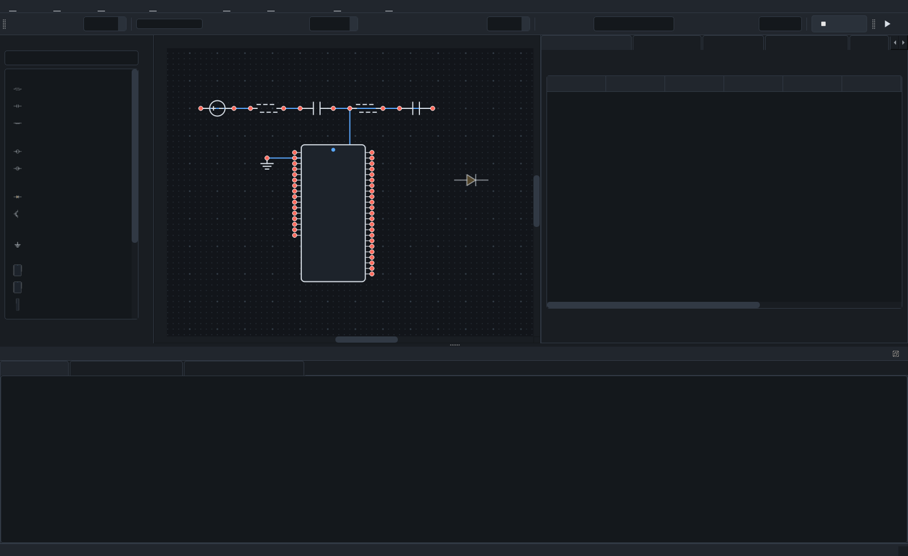
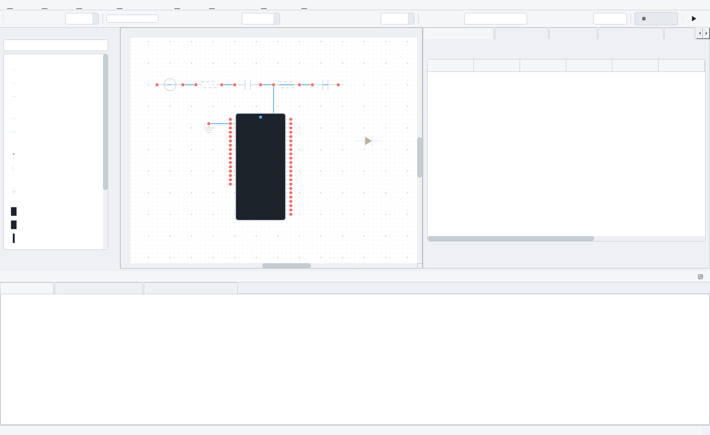

# PROJECT_WOWKISPICE ⚡

> **Real SPICE. Real MCU source. Co-simulated.**
>
> Open-source mixed-signal co-simulator built on `libngspice`. The analog engine
> runs a genuine per-timestep closed loop via ngspice's C API — no black-box
> approximations. Firmware control logic is parsed directly from ESP32 C source
> (*not yet executed as a compiled binary*) and co-simulated against the real
> circuit, including a real feedback divider in the netlist.
>
> **Read this first:** the firmware binary is *parsed, not executed* **inside the
> simulation loop**. Separately from the co-simulation, the real compiled image
> boots under Espressif's QEMU through ROM, the second-stage bootloader and
> `app_main()` — and, since the ADC/GPIO model in `tools/qemu-patch/` was
> compiled in and verified (2026-10-07), it now **runs its control loop and
> responds to analog values injected from the host** via a QEMU monitor
> command. What is still missing is the *automatic* bridge: nothing feeds
> those values from ngspice or reads the gate decision back. See
> [firmware execution status](#firmware-execution-status).

---

## 🏛️ Architecture Overview


## 🎯 Project Goals / Status

Each goal is stated as one testable sentence and flagged with the same grammar used in [docs/systems-map.md](docs/systems-map.md): **ACHIEVED** = a test or proof in this repo demonstrates it, with evidence cited; **PARTIAL** = part works and part does not, and the gap is named; **NOT YET** = something concrete is blocking it.

- [x] **ACHIEVED —** The analog solver is a real `libngspice` C DLL, not an approximation. Evidence: [tools/prove_physics_engine.py](tools/prove_physics_engine.py) and [tests/test_ngspice_dll_proof.py](tests/test_ngspice_dll_proof.py) inspect the loaded DLL and C function pointers in RAM, then verify a dynamically generated RC step response and an underdamped RLC ringing frequency/envelope against closed-form ODEs, with assertions that raise on failure.
- [x] **ACHIEVED —** The repo can run a genuine per-timestep closed-loop co-simulation between an analog solve and a firmware-derived controller. Evidence: `tests/test_cosim_control.py` (34 tests) and `tests/test_closed_loop_buck.py` (3 tests) exercise `bridge/cosim_runner.py` and `bridge/control_law.py`, including real runs where `GetVSRCData` reads the sense net from ngspice's C buffer each timestep. Note: the controller is a Python model whose three constants were scraped from the C source — see the fidelity gap below.
- [x] **ACHIEVED —** The closed loop includes a real feedback divider that lives in the SPICE netlist, not a Python fudge factor. Evidence: `tests/test_cosim_control.py::TestDividerSemantics` and `TestThresholdsMatchFirmware` assert the divider semantics and that both closed-loop paths reproduce the firmware's 1995/2030 counts; `test_schematic_editor.py` asserts the palette symbol pin order matches the netlister.
- [x] **ACHIEVED —** There is an LTspice-familiar schematic editor UX. Evidence: `tests/test_ui_polish.py` (76), `tests/test_editor_workflow.py` (36), `tests/test_schematic_editor.py` (40), and `tests/test_ui_parity.py` (12) cover placement, wiring, hotkeys, zoom/pan, undo, value editing, net labeling, simulation, and KiCad export. The palette shortcut letters are the same functional grammar used by LTspice/KiCad; the icon artwork is drawn at runtime from own geometry, not imported.
- [x] **ACHIEVED —** The compiled firmware boots in an emulator through ROM, the second-stage bootloader, and `app_main()`. Evidence: `bridge/qemu_orchestrator.py` boots `firmware/.../qemu_flash.bin` under Espressif QEMU and reaches both `BOOT_MARKERS` on UART (5 ROM boots, 5 `app_main()` entries). This is boot, not the control loop.
- [ ] **PARTIAL —** The compiled firmware boots **and** runs its real control loop in the patched emulator, **and** responds to analog values injected from the host — but only through a manual QEMU monitor command, not the automatic bridge that is the actual goal. Evidence: `qemu-system-xtensa` built from the pinned Espressif tree with `tools/qemu-patch/0001-esp32-model-sar-adc-and-gpio-output.patch` (regenerated from the working tree, re-verified by configuring and fully building a **fresh source export + patch**); a 90 s boot yields **900 000 control-loop samples with zero panics** — the former `adc_oneshot_read()` watchdog panic is gone — and `qom-set /machine/peripheral/sens adc1-value <n>` changes the sample reported on the next iteration, flipping the gate **ON → OFF at 3456** (the firmware’s own hysteresis reacting to injected input). What this is **not** yet: feeding is **manual** (a monitor command) — the automatic orchestrator bridge (ngspice ↔ QEMU) that would make compiled firmware *drive the simulation loop* is **not yet wired**; `bridge/qemu_orchestrator.py` neither sets `adc1-value` nor reads the gate decision back, so no closed loop passes through the emulated chip yet. That is the open goal, now closer. Details: [docs/systems-map.md](docs/systems-map.md) §4/§8 and the "Firmware execution status" table.
- [x] **ACHIEVED —** An open-source license is in place. Evidence: `LICENSE` is Apache-2.0; [README.md](README.md#📄-license) states it. Third-party material is handled explicitly: Qucs-S is studied, not copied (GPL-2.0-or-later cannot mix into Apache-2.0); LTspice screenshots are local-only and gitignored.
- [ ] **NOT YET —** CI is not verified as passing on a fresh clone. Evidence: `.github/workflows/cosim-ci.yml` exists and is YAML-parsed/step-order-checked, but it has never executed in CI history in this environment (no Docker, no remote). The workflow does include a `python tools/run_tests.py` step, which is the same runner that locally produces **309 tests across 17 suites, exit 0** — so the test suite itself is ready, but the CI path is **UNVERIFIED**, not CONFIRMED WORKING. Also **NOT YET** in the literal sense: a fresh clone needs two things the repo does not contain — a Python environment and `libngspice` — and the setup scripts (`setup.ps1` / `setup.sh`) fetch the DLL rather than including it.

One honesty caveat carried from [docs/systems-map.md](docs/systems-map.md): the test suite covers the Python controller matching three scraped constants in a C file. It does **not** mean the compiled firmware drives the simulation loop or that the thresholds are calibrated. Two things this caveat used to warn about are now settled — the QEMU patch compiles and is reproducible from a fresh source export, and an analog↔emulated-chip data path exists — but that path is a **manual** `qom-set` command, not an automatic bridge, so the firmware-execution goal is still PARTIAL.

```
┌────────────────────────────────────────────────────────┐
│               FIRMWARE CONTROL LOGIC                   │
│  • Bare-metal ESP32 C code, built with PlatformIO       │
│  • Decision logic + constants parsed from the .c        │
│  • Compiled .elf boots in QEMU; its ADC read is unsolved│
└───────────────────────────┬────────────────────────────┘
                            │
                 PER-TIMESTEP CLOSED LOOP
       • ngspice calls back into Python on every dt
       • Reads the simulated feedback net
       • Quantises it to 12-bit ADC counts
       • Evaluates the imported law, returns pin voltage
                            │
┌───────────────────────────┴────────────────────────────┐
│                    ANALOG CIRCUIT                      │
│  • Buck / Boost / Power Stages & Motor Subcircuits     │
│  • ngspice solving non-linear DAEs & RLC matrices      │
│  • A real feedback divider, present in the netlist     │
└────────────────────────────────────────────────────────┘
```

---

## 🚀 Quickstart Guide

### 1. Setup — from a fresh clone

PROJECT_WOWKISPICE needs two things that are not in the repository: a Python environment, and the `libngspice` shared library (the analytic solver is the whole point — nothing here is faked). **Never done this before? Follow [SETUP.md](SETUP.md) — every step from a bare Windows machine, including WSL2, PlatformIO and the QEMU build.**

**Windows**
```powershell
git clone <this-repo>
cd PROJECT_WOWKISPICE
powershell -ExecutionPolicy Bypass -File setup.ps1
```

**Linux / macOS**
```bash
git clone <this-repo>
cd PROJECT_WOWKISPICE
./setup.sh
```

The scripts are idempotent — re-run them any time.

| Platform | What setup does |
|---|---|
| Windows | Creates `.venv`, installs `requirements.txt`, downloads the official `ngspice-47_dll_64.7z` (4.4 MB) from SourceForge, verifies its SHA-256, extracts it to `tools/ngspice_dll/`, and confirms the loader can actually bind it. |
| Linux / macOS | Creates `.venv`, installs `requirements.txt`, then requires a **system** ngspice, which ngspice does not publish prebuilt binaries for. `setup.sh` prints the exact `apt` / `dnf` / `pacman` / `brew` command. |

#### Why isn't ngspice committed?
It is 12.9 MB of vendor binary, and `tools/ngspice_dll/` is gitignored. The
setup scripts fetch it instead, so the repository stays small and the
dependency is explicit.

#### If you already have libngspice
```bash
export WOSP_NGSPICE_LIB=/full/path/to/libngspice.so   # Linux / macOS
```
The resolver checks, in order: an explicit `NgSpiceEngine(dll_path=...)`
argument, then `$WOSP_NGSPICE_LIB`, then the bundled Windows DLL, then
`ctypes.util.find_library("ngspice")`. It raises only if all four fail, and the
error lists every path it tried.

### 2. Verify the install
```powershell
.\run_selfcheck.bat         # Windows — one-command environment gate
python tools/selfcheck.py   # Linux / macOS
```
The self-check is the gate: interpreter, dependencies, loading `ngspice.dll`, a
known circuit solved against hand-checkable answers (an RC step and a resistor
divider), then the suites. It prints `SELF-CHECK: PASS` and exits 0 only when
everything works; add `--quick` to skip the full suite. If anything ever looks
wrong, run this first.

```powershell
.\run_tests.bat          # Windows — suites only
python tools/run_tests.py   # Linux / macOS
```
All 17 suites (309 tests) run against the real solver.

### 3. Launch the Schematic Editor (flagship PyQt5 app)
```powershell
python ui/schematic_editor.py
```

The editor is LTspice-shaped: component palette on the left, schematic canvas
in the middle, waveform viewer on the right, console + generated SPICE netlist
at the bottom.

| Gesture | Action |
|---|---|
| Place a part | Press its letter — <kbd>R</kbd> <kbd>C</kbd> <kbd>L</kbd> <kbd>D</kbd> <kbd>V</kbd> <kbd>I</kbd> <kbd>M</kbd> <kbd>G</kbd> <kbd>U</kbd> <kbd>A</kbd> <kbd>N</kbd> <kbd>S</kbd> <kbd>E</kbd> — or click it in the palette, then click the canvas |
| Cancel | <kbd>Esc</kbd> — un-arms the tool, drops a pending wire, clears the selection |
| Wire | Click pin &rarr; click pin (<kbd>Esc</kbd> cancels) |
| Move / rotate | Drag a part (snaps to grid) / <kbd>Ctrl+R</kbd> |
| Edit value | Right-click &rarr; *Edit Value* (or <kbd>Ctrl+E</kbd>) |
| Label net | Right-click a wire &rarr; *Label Net* (or <kbd>Ctrl+L</kbd>) |
| Simulate | <kbd>F2</kbd> — compiles the schematic to SPICE and solves it in the real `ngspice.dll` |
| Export | File menu: SPICE netlist (`.cir`), **KiCad schematic** (`.kicad_sch`), KiCad netlist (`.net`), BOM (`.csv`) |
| Undo / redo | <kbd>Ctrl+Z</kbd> / <kbd>Ctrl+Shift+Z</kbd> |
| Zoom / pan | Mouse wheel / drag |

The schematic is the single source of truth: `bridge/cad_engine.py` resolves the
component graph into nets (union-find over wires, alias-aware pins, ground
detection) and emits a real netlist, so what you draw is what gets simulated.

**KiCad export is real, not a stub.** `bridge/kicad_export.py` writes a genuine
KiCad 9/10 schematic (embedded `lib_symbols`, symbol instances at true pin
coordinates, wires, junctions and net labels) plus a KiCad netlist. It is
verified against a real install by `tests/test_kicad_export.py`, which runs
`kicad-cli sch export netlist` on the generated file and asserts KiCad resolves
the intended nets (skipped automatically when KiCad is not installed).

### MCU co-simulation (what is real, and what isn't)

Place an **MCU** symbol from the palette, wire its pins, then right-click it:

- **Load Firmware (.hex / .elf)** parses the image and reports facts read from
  the file: format, byte size, load address, entry point, section names, SHA-256.
- **Set GPIO Pin Profile (JSON)** declares what each pin does *open loop*:
  `{"GPIO18": {"mode": "square", "freq_hz": 1000, "duty": 0.5}}` (or
  `{"mode": "static", "level": 1}`).
- **F2** then drives each wired pin as a real SPICE source, so the analog solver
  sees genuine switching voltages. The **MCU / GPIO** tab reports what the solver
  produced: logic levels, V min/max, duty cycle, edge count and measured
  frequency — measured from the waveform, not copied from the declaration.

#### MCU boards, gestures, and simulation control

**Board symbols.** The palette carries Arduino Uno / Nano / Mega 2560, STM32F103
(blue pill), ESP32 and ESP32-S3 with their real header pin names — an Uno has
`D0`–`D13` and `A0`–`A5`, an F103 has `PB0`–`PB15` — so a GPIO profile written
against a sketch means the same thing here. Each board also gets its own KiCad
symbol; a test asserts the editor and KiCad pin counts agree, because a symbol
whose pins disagree with its exported twin silently produces a wrong schematic.

**Gestures.** Ctrl+click adds/removes from the selection, double-click rotates
one part in place (single-click still drags), `Ctrl+R` rotates the selection,
`Ctrl+Y` and `Ctrl+Shift+Z` both redo. Bare letters are reserved for placing
parts, LTspice-style.

**Netlist editor.** The bottom dock has an editable SPICE pane next to the
read-only generated one. *Run this netlist* simulates your edits; *Import as
components* builds a schematic from them; *Reset to schematic* throws them away.
The reverse direction is deliberately not offered — a hand-written netlist line
has no pin coordinates, so there is nothing to draw.

**Simulation control.** Mode dropdown (Transient only / MCU only /
Co-simulation), accuracy presets (Accurate/Balanced/Fast) that scale timestep
and duration, a live progress bar, and **Stop** / `Ctrl+C` that interrupts a
running solve. The solver runs on a worker thread so the window stays responsive
and Stop is actually reachable. *Transient only* leaves MCU pins undriven and
says so in the netlist; *MCU only* shows firmware behaviour with no analog solve
and says that too.

**Pin Map** tab lists every wired pin with its net, hardware direction, role and
what drives it. The hardware column is inferred from the pin name and labelled
as such — only the datasheet is definitive.

**Serial** tab shows captured UART/print output with a live filter and a
truncation count, so a long capture never quietly lies about what it dropped.

#### Waveform analysis

The results pane has three tabs, all driven by the same solver output:

- **Waveforms** — left-click the plot to drop a cursor, again for a second one.
  The readout under the plot gives the LTspice ruler (Δt, ΔV, 1/Δt, slope) plus
  min/max/RMS/peak-to-peak for that trace. `Ctrl+K` clears cursors.
- **FFT** (`Ctrl+F`) — magnitude spectrum of the selected net in dB, with the
  dominant frequency, the bin width, the noise floor, and THD. THD is computed
  by summing the first 20 harmonic lobes; the pure-tone floor is ~0.06%, which
  matters because the naive "sum bins at integer multiples" approach reports a
  pure sine as 0.4% distorted.
- **Bode** (`Ctrl+B`) — runs its own `.ac` sweep, drawing gain and unwrapped
  phase, and reports the unity-gain crossover, phase margin and gain margin.
  If there is no crossover in range it says so instead of printing a margin
  that does not exist.

**Results menu** exports the solved data as CSV, any plot as PNG, and a
multi-page PDF report (one page per net, with statistics) via matplotlib — a
vector PDF rather than a screenshot in a wrapper.

#### Closed-loop control (the pin reacts to the circuit)

A declared profile is open loop: the pin plays a waveform regardless of what the
analog side is doing, so a regulator built that way cannot regulate. A
**control law** is different.

- **Import Control Law from Firmware (.c)** reads the real decision logic out of
  a firmware source — it picks up `#define ADC_LOW_THRESHOLD`,
  `#define ADC_HIGH_THRESHOLD` and `#define GATE_PIN` and builds a law that
  compares ADC counts at exactly those boundaries.
- **Set Control Law (JSON)** writes one by hand:
  `{"kind": "hysteretic", "pin": "GPIO18", "sense_net": "vout",
    "target_v": 3.3, "hysteresis_v": 0.05, "divider": 0.5}`
  (`"kind": "pwm"` with `carrier_hz`/`duty_gain` is also available).

The pin is then compiled as an `external` source, so ngspice calls back into
Python on every timestep: the law reads the **simulated** feedback net, quantises
it to a 12-bit ADC, decides, and returns the pin voltage for that instant. The
analog solver therefore sees a pin that reacts to the circuit.

Measured on the buck built in `tests/test_cosim_control.py` (law imported from
`firmware/esp32_buck_controller/src/main.c`, which targets 2048 counts ≈ 1.65 V
through a 1× divider):

| Load | Steady-state Vout | Pin duty | Switch events |
|------|-------------------|----------|---------------|
| 5 Ω  | 1.608 V           | 16 %     | 1500          |
| 1.5 Ω| 1.608 V           | 10 %     | 854           |
| 0.5 Ω| 1.610 V           | 2 %      | 52            |

Output holds target across a 10× load sweep while the pin's duty cycle visibly
responds — which it can only do if it is reading the circuit. Retuning the
thresholds moves the operating point (1024 counts → 0.825 V, 3072 counts →
2.481 V).

> **Limitation, stated plainly:** inside the co-simulation loop the firmware
> *binary* is still parsed, not executed — what executes there is the decision
> logic and its constants, lifted from the firmware's own source. Separately,
> the patched Espressif QEMU boots the compiled `.elf` through ROM, the
> bootloader, `app_main()` and a full control loop — **900 000 samples / 90 s,
> zero panics** — and a manual `qom-set /machine/peripheral/sens adc1-value N`
> feeds it analog values it visibly reacts to (gate ON → OFF at 3456). Nothing
> yet couples that guest to the analog solver *automatically*. The netlist says
> which mode a pin is in, and the editor never shows a behaviour the solver did
> not produce.

#### Firmware execution status

What each "firmware" capability actually does today:

| Capability | Status |
|---|---|
| Parse `.hex` / `.elf` (size, load address, entry point, sections, SHA-256) | **Works.** `bridge/firmware.py` |
| Import control constants from firmware **source** (`#define` regex) | **Works.** `bridge/control_law.py` |
| Declared GPIO pin profiles (authored JSON) | **Works.** `bridge/gpio_model.py` |
| Close the loop against a real ngspice solve | **Works.** `bridge/cosim_runner.py` |
| Execute compiled machine instructions | **Works (patched QEMU).** The real `.elf` runs through ROM, bootloader, `app_main()` and the full control loop: **900 000 samples / 90 s, zero panics**. `bridge/qemu_orchestrator.py` reads its UART but does not yet feed it values (not coupled to ngspice). |
| Run the firmware's control loop | **Works (patched QEMU), verified 2026-10-07** on a build made from `tools/qemu-patch/` + the pinned source. Under *stock* QEMU it still fails as before: 4 watchdog panics / 45 s, **0 control-loop samples** (`esp32.sens` unimplemented, `esp32_gpio_write()` drops writes). |
| Respond to injected analog values | **Works, manually.** `qom-set /machine/peripheral/sens adc1-value N` (QEMU monitor) changes the sample the firmware prints; the gate flips **ON → OFF at 3456**. Fixed QOM path, identical across boots. |
| Fix the above | **Done and verified.** `tools/qemu-patch/0001-*.patch` (6 files, 431 insertions) compiles, boots, and was re-verified end to end from a fresh source export + patch. The automatic ngspice ↔ QEMU bridge is the remaining, deliberately deferred step. |
| Renode lockstep co-simulation | **Abandoned and removed (2026-10-09).** The four-file cluster (`renode_orchestrator.py`, `renode_adc_peripheral.py`, `run_cosim.resc`, `esp32_buck.repl`) and the gitignored `tools/renode/` tree were deleted. Renode cannot decode the Xtensa `entry` instruction (393 occurrences in an ESP-IDF build) and executed none of our firmware; QEMU is the current emulator target. The CI/Docker benchmark entry point now calls the pure-Python `bridge/mock_controller.py` directly. |
| Run a firmware **binary** as the closed-loop controller (binary runner) | **Planned; implementable now.** Patched QEMU already executes the real image and accepts ADC injection — the host bridge is specified in [docs/binary-runner-and-mcu-bringup.md](docs/binary-runner-and-mcu-bringup.md). |

There is no code path from a `.bin`/`.elf` to GPIO or ADC behaviour *inside the
simulation*. Loading an image gives you metadata; behaviour comes from
separately importing the `.c` source or hand-writing a law. See
`tools/qemu-patch/README.md` for the register-level detail.

### Analysis-mode wiring status (per the analysis-mode audit)

The editor now exposes every analysis the audit classified as "engine exists,
not wired". These were **named, scoped items**, not silently absent:

- **DC curve tracer / semiconductor I-V** - `bridge/studio_engine.trace_mosfet_iv`
  and `trace_diode_iv` already exist and run real `.dc` sweeps; the editor now
  wires them through the **I-V Curve Tracer** tab (Simulate ▸ Run I-V Curve
  Tracer, `Ctrl+Shift+D`). This was the confirmed quick win.
- **Parametric sweep UI** (e.g. Rload or Vin vs Vout) - now wired: the
  **Parametric Sweep** tab (Simulate ▸ Run Parametric Sweep, `Ctrl+Shift+S`)
  re-solves the schematic once per step, overlays the curves, and restores the
  document afterwards.
- **UART packet decode in the editor** - now wired: the **Serial** tab has a
  net picker + baud selector + **Decode TX** button that runs
  `studio_engine.decode_uart_packets` over the last run's trace (mid-swing
  threshold → uniform 4-samples-per-bit grid → 8N1 deserialize). The decoder's
  canned demo fallback is filtered out, so an undecodable trace reports "no
  valid frames" instead of inventing packets.
- **Real per-schematic Monte Carlo / yield** - now wired: the **Monte Carlo** tab
  (Simulate ▸ Run Monte Carlo / Yield, `Ctrl+Shift+M`) runs
  `bridge/analysis_runner.run_monte_carlo`, which perturbs every R/C/L by a
  tolerance and **re-solves the drawn schematic** once per sample, then reports
  sigma, min/max and yield against spec as a histogram. (The studio engine's
  `run_monte_carlo` remains what it was: a parametric model of a fixed buck.)
- **Timing / logic diagram view for GPIO transitions** - now wired: the **Timing**
  tab (Simulate ▸ Show Timing Diagram, `Ctrl+Shift+G`) stacks a thresholded
  digital lane per trace of the last run with edge count, duty and measured
  frequency; flat traces are drawn as honest constant lanes.
- **Noise / distortion (.noise, .disto)** - now wired: the **Noise** tab
  (`Ctrl+Shift+N`) and **Distortion** tab (`Ctrl+Shift+T`). The compiler emits
  `.noise V(out) src dec …` and `.ac` + `.disto` (with the `distof1` source
  keyword); `analysis_runner.run_noise` / `run_disto` locate ngspice's plots by
  description (the numbers increment inside a shared session), and HD2/HD3 are
  reported as harmonic/fundamental ratios in dBc. Noise density is verified
  against √(4kTR) in the tests.
- **Interactive step-response / propagation-delay viewer** - now wired: the
  **Step Response** tab (Simulate ▸ Step Response Metrics, `Ctrl+Shift+E`)
  runs `bridge/measurements.step_metrics` on any net of the last run and draws
  the settled level, the ±2% band and the 50% crossing while reporting delay,
  10-90% rise, overshoot, undershoot, settling and slew.

Still open (named, not started): an `.op` button, a `.dc` sweep *of the user's
own schematic* (the tracer sweeps fixed demo device models), and everything in
Phase 4 of the vision doc (AI assistant). See
`docs/analysis-mode-audit.md` and `docs/deliverables-verification.md`.

### Firmware execution status

### 4. Launch the Schematic Editor
```powershell
run_editor.bat
```
or

```powershell
python ui/schematic_editor.py
```

This is the only UI in the repository. The earlier tkinter workbench, studio and
dashboard were retired rather than kept in parallel: three half-finished shells
is worse than one finished one. The capability that lived in the studio - the
fault-injection and temperature-corner qualification battery behind
`bridge/industrial_verification.py` - is now under **Tools ▸ Qualification**.

| | |
|---|---|
|  |  |
| dark (default) | light — `Ctrl+T` |

#### Canvas

| Gesture | Action |
|---|---|
| Type in the palette filter, click a part | the symbol follows the pointer before you commit it |
| `R` `C` `L` `D` `V` `I` `M` `G` `U` | arm that part; click the sheet to drop it |
| `A` / `Shift+A` / `N` / `S` / `E` / `Shift+E` | Arduino Uno / Mega / Nano, STM32, ESP32, ESP32-S3 |
| `Esc` | cancel: un-arm the tool, drop a pending wire, clear the selection |
| Click pin → click pin | wire; `Esc` cancels |
| Left-drag on empty canvas | rubber-band select (middle/right/space-drag pans instead) |
| Wheel | zoom about the pointer; `Ctrl+0` fits |
| `Del` / `Ctrl+R` / `Ctrl+E` / `Ctrl+L` | delete, rotate 90°, edit value, label net |
| `F2` / `Ctrl+.` | run / stop the solver |
| `Ctrl+T` / `Ctrl+G` / `Ctrl+Shift+R` | appearance, grid, rulers |

The bare letter always means a *part*, following LTspice and KiCad. The
commands that used to own bare letters moved to `Ctrl` chords so that pressing
`R` cannot silently rotate whatever you meant to place. Clicking the sheet
takes keyboard focus, so the letters work whether you started from the palette
or from the canvas.

#### What is remembered between launches

Window geometry, dock layout, grid and ruler visibility, the recent-file list
and the appearance. **Simulation inputs are deliberately not remembered** —
vin, timestep, duration, accuracy and the run mode start at their defaults
every time, because a result has to be reproducible from what is on screen and
an inherited mode or timestep is indistinguishable from a bug.

Set `WOSP_SETTINGS_DIR` to keep the profile in a specific directory (used by
`tools/run_tests.py` to give each suite a clean profile).

### 5. Run Automated Co-Simulation Tests
```powershell
# Run physical proof that ngspice.dll is genuinely executing the C solver
python tests/test_ngspice_dll_proof.py

# Run baseline ctypes bridge test
python tests/test_ngspice_bridge.py

# Run closed-loop buck converter regulation test
python tests/test_closed_loop_buck.py

# Run line & load regulation parameter sweeps
python tests/test_parameter_sweeps.py

# Run reverse-engineered component library test
python tests/test_components_library.py

# Run schematic editor tests (headless, offscreen Qt)
python tests/test_schematic_editor.py

# Run KiCad export tests (uses kicad-cli if KiCad is installed)
python tests/test_kicad_export.py

# Run firmware loading + GPIO co-simulation tests
python tests/test_firmware_gpio.py

# Run closed-loop control-law co-simulation tests
python tests/test_cosim_control.py

# Run waveform analysis tests (cursors, FFT, Bode, metrics)
python tests/test_measurements.py

# Run editor workflow tests (MCU boards, gestures, netlist editor, sim control)
python tests/test_editor_workflow.py

# Run state-of-the-art studio capability tests
python tests/test_sota_suite.py

# Run industrial-grade verification battery (DO-254 / ISO 26262)
python tests/test_industrial_verification.py

# Run studio suite tests
python tests/test_studio_suite.py

# Run UI parity tests
python tests/test_ui_parity.py

# Run UI polish tests
python tests/test_ui_polish.py
```

---

## 🧭 Roadmap: industry readiness & phased plan

The industry-readiness verdict (YES as a pilot, NO as a production tool) and the
phased plan with **acceptance criteria for each phase** are documented in
**[docs/industry-readiness.md](docs/industry-readiness.md)**, which is the living
record of every go/no-go decision in this project. The same page links the
binary-runner/M0-M1 spec as the first concrete deliverable of Phase 1.

## 🧭 Roadmap: binary runner & new-MCU bring-up

Today the control loop runs from **declared** behaviour — a pin profile
(`bridge/gpio_model.py`) or a law parsed from firmware source
(`bridge/control_law.py`). The real firmware binary executes only under QEMU,
not yet wired to the solver. The next capability is a **binary runner** that
closes that loop, plus a repeatable checklist for adding and testing new MCUs.

Both are specified implementation-ready (interfaces, milestones, acceptance
tests, traps) in **[docs/binary-runner-and-mcu-bringup.md](docs/binary-runner-and-mcu-bringup.md)**; the acceptance-gates for the surrounding phases are in **[docs/industry-readiness.md](docs/industry-readiness.md)**:

- **M0 — scripted injection:** drive `qom-set /machine/peripheral/sens adc1-value N`
  from Python, read the gate back, and regression-test the measured 3456-count
  flip boundary.
- **M1 — closed loop:** feed the solver's divider voltage into the emulated ADC
  and drive the gate's `external` source from the firmware's real decisions.
- **New MCUs:** register map + QEMU device model + firmware project + pin/law
  wiring + tests, per the bring-up checklist.

## 📁 Repository Structure

* `bridge/` — Low-level `ngspice.dll` C-API ctypes bridge, the schematic→SPICE
  compiler (`cad_engine.py`), firmware parsers (`firmware.py`), GPIO models
  (`gpio_model.py`), closed-loop control laws (`control_law.py`), the
  co-simulation runner (`cosim_runner.py`), waveform analysis
  (`measurements.py`) and the FFT/Bode runner (`analysis_runner.py`),
  KiCad export, and the QEMU firmware-boot orchestrator (`qemu_orchestrator.py`).
* `circuits/` — SPICE netlists (Buck, Boost, RC Filter) & reverse-engineered component models (`circuits/components/models.lib`).
* `firmware/` — PlatformIO bare-metal C firmware project for ESP32.
* `ui/` — the application, and the only entry point:
  `schematic_editor.py` (window, menus, results panes), `schematic_scene.py`
  (placement, wiring, undo), `schematic_items.py` (symbol drawing),
  `schematic_symbols.py` (component library), `theme.py` (one palette, dark
  and light) and `icons.py` (runtime-drawn toolbar icons).
* `tools/` — `prove_physics_engine.py` (solver proof harness), `run_tests.py`,
  `selfcheck.py` (the environment gate behind `run_selfcheck.bat`),
  `screenshot_editor.py` and `overnight_ollama.py` (local LLM batch runner).
  `tools/ngspice_dll/` is a gitignored vendor binary; the gitignored `tools/renode/` tree was deleted on 2026-10-09
  (it was stale and unused — Renode cannot execute this firmware,
  see [above](#firmware-execution-status)); `tools/qemu-patch/` is the
  compiled-and-boot-tested SAR ADC + GPIO QEMU device-model patch.
  `setup.ps1` / `setup.sh` fetch ngspice on demand.
* `tests/` — Automated verification test suites and benchmark runners.
* `.github/workflows/` — Automated GitHub Actions CI/CD co-simulation workflow.
* `setup.ps1` / `setup.sh` — one-shot bootstrap (venv + deps + libngspice).
* `docs/product_vision.md` — original vision snapshot + per-slice status table.
* `docs/industry-readiness.md` — verdict, blockers, phased plan with acceptance criteria.
* `docs/capability-inventory.md` — what works today, what is manual, what is planned.
* `Dockerfile` & `docker-compose.yml` — Containerized headless execution setup.
  **Known broken:** they install a system `libngspice0` but predate the
  `find_library` fallback, and they copy neither `ui/` nor `tools/`.

---

## 📄 License

Apache License 2.0 — see [LICENSE](LICENSE).
