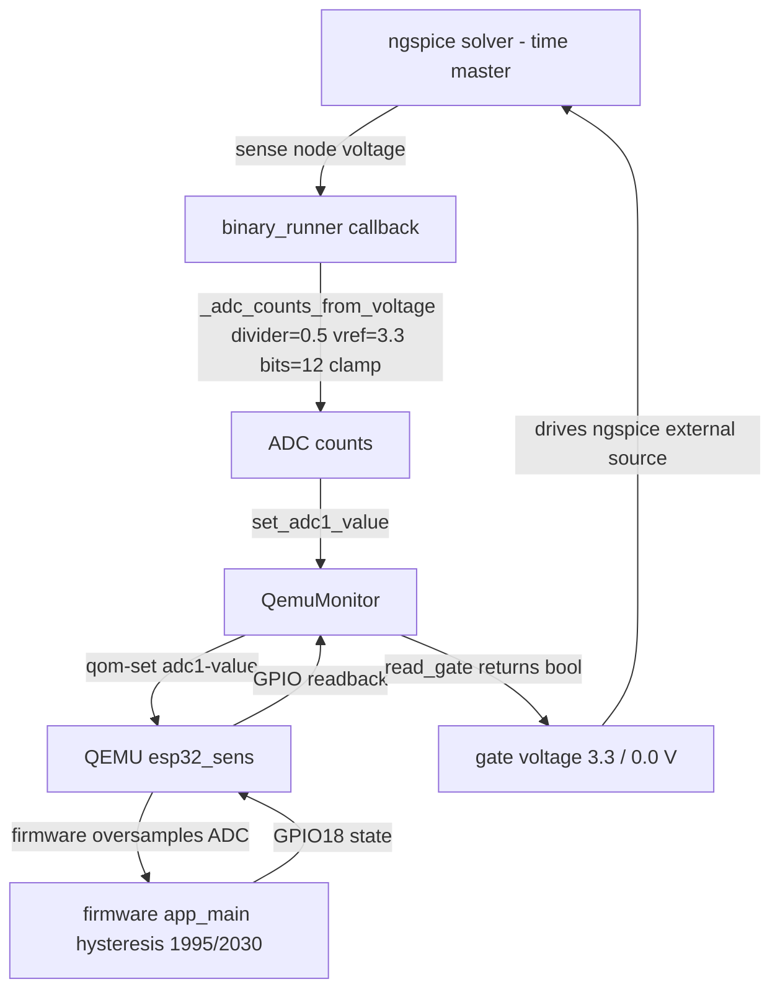

# Architecture loop - automatic ngspice <-> firmware coupling

## Where each arrow lives

| Step | Code | Status |
| --- | --- | --- |
| Sense the circuit | `bridge/binary_runner.py::run_binary_cosim` callback | implemented |
| Volts -> counts | `_adc_counts_from_voltage()` | implemented, covered by `tests/test_binary_runner.py` |
| Inject the sample | `QemuMonitor.set_adc1_value()` | implemented |
| Wait for the firmware | `_read_until_stable()` (`sync_mode="adaptive"`) | implemented; contract in `docs/time-sync.md` |
| Read the gate | `QemuMonitor.read_gate()` | implemented |
| Return the pin voltage | callback return value | implemented |
| UI gate | `WOSP_USE_BINARY_COSIM=1`, `ui/schematic_editor.py::run_closed_loop` | implemented, covered by `TestBinaryCosimBranch` |
| Real-emulator gate flip | `tests/test_qemu_monitor_qemu.py` | runs when a patched `qemu-system-xtensa` is present |
| Golden trace capture/compare | `tools/golden_trace.py`, `tools/cli.py golden-trace` | implemented; no real reference trace is committed yet |

## Synchronisation model

ngspice is the time master. For each accepted timestep the callback:

1. reads the sense node from the live solver buffer;
2. converts the voltage to ADC counts with the board divider/reference;
3. injects the counts through `QemuMonitor` over HMP;
4. waits for the firmware to act (`adaptive`: three stable gate readings,
   5 ms poll, 100 ms timeout; `fixed`: one fixed delay; `none`: read once);
5. reads the gate and returns 3.3 V or 0.0 V to the `external` source.

Defaults and measured latencies are in `docs/time-sync.md`. The coupling is
synchronous in the sense that one callback completes before the next one
starts, but it is **not** CPU-stepped lockstep: QEMU runs the firmware
asynchronously under TCG.

## Known limits

- Firmware oversamples the ADC 16x, so one injection can need several
  firmware iterations to change the gate.
- Adaptive polling is a timeout-bounded wait, not a guarantee. If the gate
  does not settle, the callback returns the last reading and the run records
  any monitor failures in `run.warnings`.
- The shipped firmware image and the committed `main.c` are the reference
  behaviour. A source-only change is not measured until the image is rebuilt.
- The golden-trace framework is implemented, but the repository still has no
  trace captured from a real emulator with recorded provenance.
